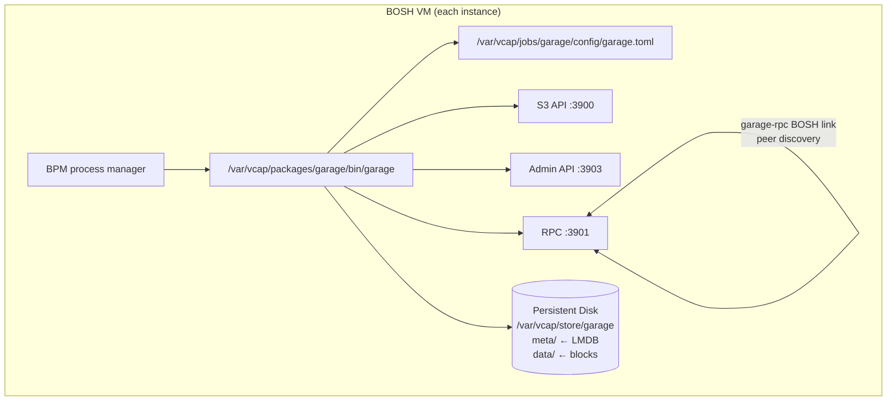

# garage-boshrelease

A BOSH release that packages [Garage](https://garagehq.deuxfleurs.fr/) — a
lightweight, S3-compatible distributed object storage system — as a
BPM-managed service for Cloud Foundry and BOSH-based platforms.

## Overview

Garage is a self-hosted, distributed object store built in Rust. It exposes an
S3-compatible API on port 3900, an admin API on port 3903, and an RPC
inter-node channel on port 3901. A single node binds the admin API to
loopback. A cluster binds it to each instance's own IP, because the
lifecycle hooks read each peer's node id and layout version from it. This
release:

- Ships the statically-linked `x86_64-unknown-linux-musl` binary as a BOSH
  blob — no compilation needed on the stemcell.
- Manages the process under BPM with correct persistent disk, ephemeral
  volume, and ulimit settings.
- Uses a `garage-rpc` BOSH link so all instances enumerate peer IPs at
  render time — no hard-coded peer list.
- Bootstraps the cluster layout idempotently from the post-deploy hook on
  the instance with the highest index (opt-out via
  `garage.layout.manual: true`), replaces the role of a node that lost its
  disk, and creates the root S3 key and the default bucket.
- Refuses a change to the replication factor before it can lose anything,
  and takes a node that BOSH is deleting out of the layout and waits until
  its data lives on the remaining nodes.
- Delivers `rpc_secret` and `admin_token` via on-disk files, not inline in
  the TOML config, and keeps every secret off command lines.

## Requirements

| Dependency | Version | Notes |
|---|---|---|
| BOSH CLI | v7+ | Required for blob management and release creation |
| BPM | any | Colocated job from the `bpm` BOSH release |
| Stemcell | ubuntu-noble or ubuntu-resolute | The job scripts need only bash, curl, openssl, getent, and awk from the stemcell |
| Persistent disk | 10 GiB+ (production: 100 GiB+) | One disk per instance; `meta/` should be SSD-backed |
| Garage binary | v2.3.0 | Fetched by `scripts/fetch blobs` (or `make download-blobs`) |

No runtime library dependencies: Garage's musl binary is fully statically
linked and has no glibc or OpenSSL requirements on the stemcell.

## Quickstart

**1. Fetch the blob:**

```bash
./scripts/fetch blobs           # or: make download-blobs
```

**2. Create a dev release:**

```bash
bosh create-release --force
bosh -e <your-director> upload-release
```

**3. Deploy (single-node example):**

```yaml
instance_groups:
- name: garage
  jobs:
  - name: garage
    release: garage
    provides:
      garage-rpc: { as: garage-rpc }
    consumes:
      garage-rpc: { from: garage-rpc }
    properties:
      garage:
        rpc_secret: "<64-char-hex-from-openssl-rand-hex-32>"
        admin_token: "<strong-random-token>"
        access_key: "GK<32-hex-chars>"
        secret_key: "<64-hex-chars>"
        replication_factor: 1
  - name: bpm
    release: bpm
  instances: 1
  persistent_disk_type: default
  ...
```

**4. Run smoke tests:**

```bash
bosh -d <deployment> run-errand smoke-tests
```

## Properties

| Property | Default | Description |
|---|---|---|
| `garage.rpc_port` | `3901` | RPC inter-node port, exported via `garage-rpc` link |
| `garage.s3_port` | `3900` | S3 API bind port |
| `garage.admin_port` | `3903` | Admin API port |
| `garage.admin_bind_address` | `""` | Admin API bind address. Empty means loopback for one node and the instance IP for a cluster |
| `garage.s3_region` | `"garage"` | S3 region label in API responses |
| `garage.s3_root_domain` | `""` | Optional vhost-style bucket domain suffix |
| `garage.replication_factor` | `1` | Replication factor (1 = dev, 3 = production) |
| `garage.db_engine` | `"lmdb"` | DB engine: `lmdb` (production) or `sqlite` (dev/test) |
| `garage.metadata_dir` | `/var/vcap/store/garage/meta` | LMDB metadata path — use SSD |
| `garage.data_dir` | `/var/vcap/store/garage/data` | Object block path — HDD-OK |
| `garage.block_size` | `1048576` | Data block size in bytes (1 MiB) |
| `garage.compression_level` | `1` | Zstd compression level (-99 to 22) |
| `garage.metadata_fsync` | `false` | Extra LMDB corruption protection (costs performance) |
| `garage.consistency_mode` | `"consistent"` | `consistent`, `degraded`, or `dangerous` |
| `garage.log_level` | `"info"` | `trace`, `debug`, `info`, `warn`, or `error` |
| `garage.rpc_secret` | *(required)* | 64-char hex cluster secret — identical on all nodes |
| `garage.admin_token` | *(required)* | Admin API bearer token |
| `garage.layout.manual` | `false` | If true, skip auto-bootstrap in post-deploy |
| `garage.layout.capacity` | `"1T"` | Capacity passed to `garage layout assign -c` |
| `garage.access_key` | *(required)* | Root S3 access key id (`GK` followed by 32 hex characters) |
| `garage.secret_key` | *(required)* | Root S3 secret key (64 hex characters) |
| `garage.default_bucket` | `"garage"` | Bucket created for the root key, and used by the smoke tests |
| `garage.drain.delete_wait_secs` | `3600` | How long drain waits for the remaining nodes to take over a deleted instance's data |
| `garage.bpm.open_files` | `65536` | BPM open_files ulimit |
| `smoke_tests.timeout_secs` | `30` | `curl --max-time` for smoke test requests |

See `jobs/garage/spec` for complete property declarations with types and
descriptions. Properties in the `smoke-tests` job mirror the main job.

## Cluster Bootstrap

A brand new single node starts with `garage server --single-node --default-bucket`. Garage then assigns the layout itself and creates the root key and the default bucket from `garage.access_key`, `garage.secret_key`, and `garage.default_bucket`. The job uses those flags only when the `garage-rpc` link has one instance and the node has no stored layout yet, because Garage refuses to start in single-node mode once the layout is past its first version. Every later start, and every start of a node in a cluster, runs plain `garage server`, and post-deploy makes sure on every deploy that the root key and the default bucket exist.

Garage accepts `--default-bucket` only together with `--single-node`, so a cluster starts without either flag, and the lifecycle hooks do that work instead. Two instances in the `garage-rpc` link have special jobs. The instance with the lowest index is the join target, and the instance with the highest index makes the layout changes. We choose both by index rather than by their position in the link, so a gap in the indexes after a scale-down or a recreate doesn't change which instance does what.

1. In post-start, every other instance reads the join target's node id from its admin API (`GET /v2/GetNodeInfo?node=self`, with the admin token) and runs `garage node connect`. The join target tries to connect to every other instance once, so a join target that comes back with a wiped disk finds the cluster again.

2. Post-start accepts a 503 from `/health` while the node has no layout yet, because a cluster has no layout until post-deploy applies one.

3. In post-deploy, the acting instance asks each instance's admin API which node it runs (`GET /v2/GetNodeInfo?node=self`). That answer is what ties a node id to a BOSH instance, because `garage status` can keep listing a node that has just gone away as healthy for close to a minute. The acting instance waits until every instance's node is up and until its own copy of the layout is as new as the newest one any peer reports, and then it checks the instances once more before it plans anything. It stops with an error if an instance is still missing after a minute, because a layout built from part of the cluster could give roles to the wrong set of nodes.

4. It also stops when the layout has staged changes that it didn't make, because `garage layout apply` would commit them without anyone reviewing them. We review them with `garage layout show`, apply them or drop them with `garage layout revert --yes`, and deploy again.

5. It gives each instance's node that has no role a role in the zone named after its BOSH AZ, with the capacity from `garage.layout.capacity`. Each role carries two tags, `bosh-id-<instance id>` and `<instance group>/<index>`. A role made by an earlier release has no `bosh-id` tag, and when the node that an instance's admin API names holds it, post-deploy adds the two tags while it keeps the role's zone, capacity, and other tags. That change is staged and applied together with any new roles, and it moves no data. Post-deploy never changes the role of a node outside the link.

6. It plans the whole change before it stages anything, so a deploy that stops leaves the layout as it was. Then it applies the next layout version, checks that every instance's node holds a role in it, imports the root key, creates the default bucket, and grants the key read, write, and owner access to it. If post-deploy fails or is interrupted after it has staged a change and before the apply, it drops what it staged with `garage layout revert --yes`.

Every step is idempotent, so later deploys find nothing to do. Every call to the `garage` CLI is limited to 30 seconds and every admin API request to at most 10 seconds, so a node that stops answering fails the deploy instead of hanging it.

When an instance has no BOSH AZ in the link, post-deploy prints a warning banner and puts the instance into the acting instance's zone. Garage spreads replicas across zones, so every instance should have an AZ. When an instance's address doesn't resolve to an IPv4 address, post-deploy stops before it changes anything, because an instance it can't check could own any of the roles the change would touch. For a production cluster with `replication_factor: 3`, each node should be in its own BOSH AZ, so that Garage places the three copies in three zones.

The capacity default of `1T` is a placeholder, and Garage uses it only to share partitions between nodes in proportion to their capacity. Every node gets the same value, so we set `garage.layout.capacity` to roughly the usable size of the persistent disk, and we give every instance the same disk size.

### Manual layout

With `garage.layout.manual: true`, post-deploy never changes the layout, and we assign roles by hand with `garage layout assign` and `garage layout apply`. Until a layout exists, post-deploy logs that it's waiting for one. On the first deploy after we apply a layout, it creates the root key and the default bucket.

### Replacing a lost node

A node whose persistent disk is lost or recreated starts with a new node id and no role, and Garage keeps listing its old role as failed. Post-deploy replaces an old role only when it can prove the role belongs to the BOSH instance it's acting for. When it can't, it prints a warning that names the role and gives the exact commands to run by hand, and it leaves the layout alone. A healthy node that is down for a moment, a node outside the `garage-rpc` link, and a node that we added by hand are never touched.

For each instance whose node has no role, post-deploy checks the layout in this order.

1. BOSH keeps the instance id across a recreate. When exactly one role that no link instance's node holds carries the tag `bosh-id-<instance id>`, that role is the instance's old identity, and the new node replaces it with `garage layout assign --replace <old id>`. The new role keeps the old role's tags, apart from its `bosh-id` tag, which is written again. Garage hands the old node's partitions to the new one and copies the data back from the surviving replicas.

2. When more than one such role carries the tag, or the tagged role's node is still listed as up at an address other than the instance's own, post-deploy stops with nothing changed and lists the roles.

3. When no role carries the tag, but the layout holds a role that no instance can be proven to own, and its node is either down or still listed at the address of a link instance that now runs another node, post-deploy stops with nothing changed. That role could be the instance's old identity from a disk that was lost before any release tagged it, or a node outside the link that is down for a moment, and post-deploy can't tell the two apart. A role whose node is up at an address outside the link belongs to someone else, and it doesn't stop the deploy.

4. Otherwise the node gets a new role, as it does when the cluster grows.

When post-deploy stops, its message prints a `garage layout assign <new id> -z <zone> -c <capacity> -t bosh-id-<instance id> -t <instance group>/<index> --replace <old id>` command for each role that could be the old identity, and the command that gives the node a role of its own instead. We run the one that fits, check the staged change with `garage layout show`, apply it with `garage layout apply --version <next version>`, and deploy again. Post-deploy never removes a role.

A replace leaves the previous layout version waiting for the old node to acknowledge the new one, which it never will. Post-deploy waits up to 90 seconds for Garage to list the replaced nodes as failed, and then runs `garage layout skip-dead-nodes`. That command marks every node that is down as caught up, not only the replaced ones, so post-deploy runs it only when the replaced nodes are the only nodes in the live layout versions that are down. Otherwise it prints a warning with the reason and the exact `garage layout skip-dead-nodes --version <version>` command, and the deploy still succeeds. We run that command once the replaced nodes are the only failed ones. If a failed role is still in the layout at the end, post-deploy prints a warning with its id, and we deal with it by hand with `garage layout remove` or `garage layout assign --replace`.

### Root key and bucket

Post-deploy checks the root key, the default bucket, and the key's read, write, and owner grant on the bucket before it touches any of them, so a cluster that already has all three sees no writes. A step is written only when its check shows that it's missing. When a check can't get an answer, for example because the cluster has no quorum, the step is retried and never written blind. Bucket and key writes need a quorum in every live layout version, which can take a while right after a layout change, so each step is retried for at least three minutes, and at most about four, before the deploy fails with the last error. When Garage rejects the root key itself, for example because `garage.access_key` isn't a valid Garage key id, the deploy fails at once with Garage's reason. The secret never appears in the output.

## Scaling

Every change to `instances` changes the peer list that's rendered into each node's configuration, so BOSH restarts every instance, one at a time, on every scale. The replication factor never changes on a scale, as [Replication Factor](#replication-factor) explains, so a cluster always keeps at least as many nodes as its replication factor.

### Scaling up

We raise `instances` and deploy. The new instances join through the join target, and because the acting instance is the one with the highest index, one of the new instances gives them their roles. Garage then moves partitions onto the new nodes in the background.

A deployment that grows from one instance to several keeps its replication factor of 1, so every object still lives on exactly one node. Its admin API moves from loopback to the instance IP. Single-node mode gave the first node's role the zone `dc1`, the tag `default`, and the size of its disk as its capacity, so post-deploy moves that role to the zone of its BOSH AZ with `garage.layout.capacity`, in the same layout change that adds the new nodes. Without that move, Garage would leave the first node out of a cluster whose other nodes all sit in other zones and hold far more capacity, and the first node would end up with no data. To get redundancy, we build a new cluster with a higher replication factor and copy the data across, as [Moving data to a new cluster](#moving-data-to-a-new-cluster) describes.

### Scaling down

We lower `instances` and deploy, and the garage job's drain script takes each departing node out of the cluster before BOSH deletes its disk. BOSH deletes the departing instances before it updates the remaining ones, and drain runs on each departing instance in turn.

1. Drain checks that the layout is stable, that nothing is staged, that no node holding a role is down, and that the nodes left behind are still at least as many as the replication factor. When any check fails, drain refuses and the deploy stops with nothing changed.

2. It stages `garage layout remove` for its own node, waits 15 seconds, and checks that its own removal is the only staged change and that the layout version hasn't moved. Otherwise it drops what it staged with `garage layout revert --yes` and refuses, so it never applies a change that someone else made.

3. It applies the next layout version from its own node. When Garage rejects the new layout, for example because the remaining zones can't hold every copy, drain drops the staged removal and refuses.

4. It waits until `garage layout history` reports a stable state with a single live layout version, and until the node's data directory holds no blocks and its resync queue is empty. Only then does BOSH stop the node and delete it.

Garage doesn't track block moves in the layout. A layout can be stable while the departing node still holds the only copy of some blocks, and when `garage layout history` reports a stable state, it also says that block migration isn't tracked and that old nodes should stay online until their data directories are empty. So drain waits for the empty data directory as well. Garage starts deleting a block from a node that no longer stores it about ten minutes after the block's last reference has moved, which means each departing node takes at least ten to fifteen minutes even when it holds very little. When blocks are still left fifteen minutes after the layout settled and nothing is queued, drain queues every local block once with `garage repair --yes blocks`.

Drain waits up to `garage.drain.delete_wait_secs`, an hour by default, for the data to move. When that runs out, it fails the deploy with what it's still waiting for. The node holds no role by then and keeps running, so nothing is lost, and the next deploy finds the role gone and goes straight back to waiting.

BOSH must delete the departing instances one at a time, with `max_in_flight: 1`. Two drains that apply layout versions at the same moment would give Garage two different layouts with the same version number, which Garage can't reconcile. Each drain checks for a concurrent change before it applies, but a parallel scale-down is still unsafe, so we never scale down with `--max-in-flight` above 1 or with an update block that runs instances in parallel.

A scale-down to a single instance works when the replication factor is 1. Drain removes every other node, and the last node keeps the cluster's layout and starts as plain `garage server`, because single-node mode refuses a layout that is past its first version. A cluster with a higher replication factor can't go below that many nodes, so it moves its data to a new single-node deployment instead.

We can still take a node out by hand before a deploy, with `garage layout remove <node id>` and `garage layout apply --version <next version>`. Drain then finds the role gone and only waits for the data to move. We don't deploy without lowering `instances` in the meantime, because post-deploy gives every node in the link its role back.

Deleting the whole deployment with `bosh delete-deployment` needs no `--force`. Pre-stop tells drain that the whole deployment is going away, and drain lets BOSH go ahead at once. If a departing node's process can't run, drain refuses, because it can't tell whether the node still holds data. We only deploy with `--skip-drain` for that instance group after we've confirmed that the node's role is gone and that its data exists on the other nodes.

### Moving data to a new cluster

Garage can't change the replication factor of a cluster, so a change of replication factor, or a cluster with a factor above 1 that should end up on one node, means a second deployment and a copy.

1. Deploy a second Garage deployment with the new shape, under its own deployment name and on its own IPs.

2. Create each bucket on the new cluster, and copy every object across with an S3 tool, for example `rclone sync old:<bucket> new:<bucket>`. A key that we created by hand on the old cluster is created again on the new one.

3. Stop writes to the old cluster, run the copy again so it picks up the last changes, and compare the object lists and checksums, for example with `rclone check old:<bucket> new:<bucket>`.

4. Point clients at the new cluster, and delete the old deployment once nothing uses it.

### Drain on an ordinary stop

When BOSH stops or updates an instance without deleting it, drain waits up to two minutes for the node's block resync queue to empty, so blocks on their way to other nodes aren't cut off. Drain never stops the process itself. bpm stops it after drain returns.

## Replication Factor

Garage can't change the replication factor of a cluster that already has a layout. It refuses to start when the configured value differs from the stored one, and the resulting crash loop is hard to read. Pre-start therefore records the value in `/var/vcap/store/garage/replication_factor` the first time a node starts, and on every later start it compares that value with `garage.replication_factor`. When they differ, pre-start fails before Garage starts and prints what to do. bpm runs the same check before every start, so a restart by monit is covered too.

To keep the cluster, we set `garage.replication_factor` back to the recorded value and deploy again. To move to a new replication factor, we deploy a second Garage cluster with the new value and copy the data across, as [Moving data to a new cluster](#moving-data-to-a-new-cluster) describes. We never try to get around the check by deleting files under the metadata directory, because those files hold the cluster's layout.

A node from an older release has a layout but no marker. Pre-start lets it start, Garage itself checks the stored layout against the configuration, and post-start writes the marker once Garage is running with that value.

## Starting a Stopped Cluster

When every node is down, BOSH still starts them one at a time. The first nodes to start find their peers down and have no quorum, so `/health` answers 503. Post-start waits 45 seconds, and if `garage status` then lists some peers as failed, it accepts the start with a warning so that BOSH goes on to the next instance. The cluster serves reads and writes again once enough nodes are up, and we check `garage status` after the deploy.

A node that can reach all of its peers and still answers 503 after two minutes fails post-start, because something other than missing peers is wrong. A new node with no layout yet is always accepted, because post-deploy gives it a role later.

## Secrets

The RPC secret and the admin token are written by pre-start to files that only `vcap` can read, and `garage.toml` points at those files. The lifecycle scripts never pass a secret on a command line. They send the admin token to the admin API through a curl header file (`curl -H @file`) that only root can read. Post-deploy imports the root S3 key through the admin API (`POST /v2/ImportKey`), with the secret read from another root-only file that pre-start writes, because `garage key import` would put the secret on the command line.

The smoke-tests errand computes its AWS Signature Version 4 HMACs in bash and pipes the input to `openssl dgst -sha256`, so no key material appears on a command line there either. Its secret key comes from a rendered configuration file that the errand restricts to root before it reads it.

The admin API in a cluster listens on the instance IP so that the hooks can read each peer's node id and layout version, and every request to it needs the admin token.

## Upgrading from 0.0.1 (Garage v1)

Release 0.0.1 packaged Garage v1.3.1, and this release packages Garage v2.3.0. Garage v1 and v2 nodes can't run in the same cluster, so a rolling upgrade doesn't work. The [upstream migration guide](https://garagehq.deuxfleurs.fr/documentation/working-documents/migration-2/) says to stop every node and start them all again on v2 at the same time. Garage v2 marks its stored layout the same way v1 does, so the release can't tell a v1 node from a v2 node, and following this procedure is up to us.

1. On any node, run `garage repair --all-nodes --yes tables`, and wait until `garage worker list` shows the repair workers as done.

2. Run `garage meta snapshot --all`. Then copy `snapshots`, `cluster_layout`, `data_layout`, `node_key`, and `node_key.pub` from `/var/vcap/store/garage/meta` on every node to somewhere safe, for example with `bosh scp`.

3. Release 0.0.1 already used `replication_factor` rather than v1's `replication_mode`, so the configuration needs no change for that. Keep `garage.replication_factor` and `instances` exactly as they are for this deploy.

4. Deploy the new release with `bosh deploy --canaries=0 --max-in-flight=100%`, so that BOSH stops every instance and starts them all together.

5. Check `garage status` and `garage layout show`, run the `smoke-tests` errand, and keep an eye on the cluster for the next few hours.

Nodes from 0.0.1 have no replication factor marker, and post-start writes one during this deploy. Their roles have no tags either, and post-deploy tags every one that a link instance's node holds during this deploy. If a node lost its disk before the upgrade, post-deploy can't tell which untagged role was its own, so it stops and prints the `garage layout assign ... --replace` command for that node, as [Replacing a lost node](#replacing-a-lost-node) describes. We run it, apply the layout, and deploy again.

## Architecture



## Smoke Tests

The `smoke-tests` BOSH errand performs a full S3 round trip against the
cluster with the root key, so it needs no extra key setup. It consumes the
`garage-rpc` link and the `garage.access_key`, `garage.secret_key`, and
`garage.default_bucket` properties. Run it with:

```bash
bosh -d <deployment> run-errand smoke-tests
```

The errand:

1. Probes `GET http://<peer>:3900/` on every peer and fails if any peer does
   not answer.
2. Uploads a small object with a unique key (`smoke-<epoch>-<pid>`) to the
   default bucket via PutObject.
3. Downloads it via GetObject and compares the content.
4. Deletes it via DeleteObject.
5. Confirms it is gone via HeadObject, which must return 404.

Auth uses AWS Signature Version 4, signed with HMACs computed in bash over `openssl dgst -sha256`. No packages beyond the stemcell's base tools are needed. The errand has been exercised against OpenSSL 3.5 and the uutils coreutils that Ubuntu 26.04 resolute ships.

## Release Process

Final releases are created by the `.github/workflows/release.yml` workflow
on tag push. The workflow:

1. Installs the latest BOSH CLI.
2. Downloads the Garage binary from the upstream CDN.
3. Verifies the SHA256 digest.
4. Runs `bosh add-blob` and `bosh upload-blobs`.
5. Runs `bosh create-release --final --version <tag>`.
6. Publishes the `.tgz` and its SHA256 checksum to GitHub Releases.

To trigger a release: push a `v`-prefixed tag (e.g., `git tag v0.2.0 && git push --tags`).

## Contributing

See [CONTRIBUTING.md](CONTRIBUTING.md) for the development workflow, blob
management instructions, and PR guidelines.

## License

Apache License 2.0. See [LICENSE](LICENSE).

Copyright 2026 Cloud Foundry Community.
