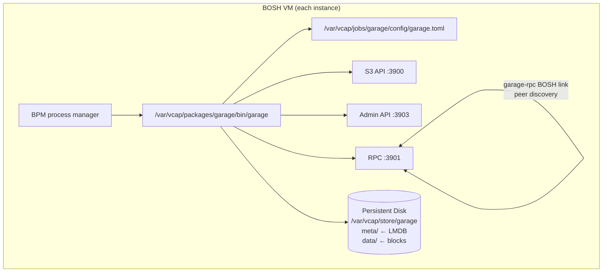

# garage-boshrelease

A BOSH release that packages [Garage](https://garagehq.deuxfleurs.fr/) — a
lightweight, S3-compatible distributed object storage system — as a
BPM-managed service for Cloud Foundry and BOSH-based platforms.

## Overview

Garage is a self-hosted, distributed object store built in Rust. It exposes an
S3-compatible API on port 3900, an admin API on port 3903, and an RPC
inter-node channel on port 3901. A single node binds the admin API to
loopback. A cluster binds it to each instance's own IP, because a joining
node reads the first node's id from it. This release:

- Ships the statically-linked `x86_64-unknown-linux-musl` binary as a BOSH
  blob — no compilation needed on the stemcell.
- Manages the process under BPM with correct persistent disk, ephemeral
  volume, and ulimit settings.
- Uses a `garage-rpc` BOSH link so all instances enumerate peer IPs at
  render time — no hard-coded peer list.
- Bootstraps the cluster layout idempotently from the post-deploy hook on
  the last instance (opt-out via `garage.layout.manual: true`), and creates
  the root S3 key and the default bucket.
- Delivers `rpc_secret` and `admin_token` via on-disk files, not inline in
  the TOML config, to avoid secrets appearing in rendered templates.

## Requirements

| Dependency | Version | Notes |
|---|---|---|
| BOSH CLI | v7+ | Required for blob management and release creation |
| BPM | any | Colocated job from the `bpm` BOSH release |
| Stemcell | ubuntu-noble or ubuntu-resolute | The job scripts need only bash, curl, openssl, getent, and awk from the stemcell |
| Persistent disk | 10 GiB+ (production: 100 GiB+) | One disk per instance; `meta/` should be SSD-backed |
| Garage binary | v2.3.0 | Fetched by `scripts/fetch blobs` (or `make download-blobs`) |

No runtime library dependencies: Garage's musl binary is fully statically
linked and has no glibc or OpenSSL requirements on the stemcell.

## Quickstart

**1. Fetch the blob:**

```bash
./scripts/fetch blobs           # or: make download-blobs
```

**2. Create a dev release:**

```bash
bosh create-release --force
bosh -e <your-director> upload-release
```

**3. Deploy (single-node example):**

```yaml
instance_groups:
- name: garage
  jobs:
  - name: garage
    release: garage
    provides:
      garage-rpc: { as: garage-rpc }
    consumes:
      garage-rpc: { from: garage-rpc }
    properties:
      garage:
        rpc_secret: "<64-char-hex-from-openssl-rand-hex-32>"
        admin_token: "<strong-random-token>"
        access_key: "GK<32-hex-chars>"
        secret_key: "<64-hex-chars>"
        replication_factor: 1
  - name: bpm
    release: bpm
  instances: 1
  persistent_disk_type: default
  ...
```

**4. Run smoke tests:**

```bash
bosh -d <deployment> run-errand smoke-tests
```

## Properties

| Property | Default | Description |
|---|---|---|
| `garage.rpc_port` | `3901` | RPC inter-node port, exported via `garage-rpc` link |
| `garage.s3_port` | `3900` | S3 API bind port |
| `garage.admin_port` | `3903` | Admin API port |
| `garage.admin_bind_address` | `""` | Admin API bind address. Empty means loopback for one node and the instance IP for a cluster |
| `garage.s3_region` | `"garage"` | S3 region label in API responses |
| `garage.s3_root_domain` | `""` | Optional vhost-style bucket domain suffix |
| `garage.replication_factor` | `1` | Replication factor (1 = dev, 3 = production) |
| `garage.db_engine` | `"lmdb"` | DB engine: `lmdb` (production) or `sqlite` (dev/test) |
| `garage.metadata_dir` | `/var/vcap/store/garage/meta` | LMDB metadata path — use SSD |
| `garage.data_dir` | `/var/vcap/store/garage/data` | Object block path — HDD-OK |
| `garage.block_size` | `1048576` | Data block size in bytes (1 MiB) |
| `garage.compression_level` | `1` | Zstd compression level (-99 to 22) |
| `garage.metadata_fsync` | `false` | Extra LMDB corruption protection (costs performance) |
| `garage.consistency_mode` | `"consistent"` | `consistent`, `degraded`, or `dangerous` |
| `garage.log_level` | `"info"` | `trace`, `debug`, `info`, `warn`, or `error` |
| `garage.rpc_secret` | *(required)* | 64-char hex cluster secret — identical on all nodes |
| `garage.admin_token` | *(required)* | Admin API bearer token |
| `garage.layout.manual` | `false` | If true, skip auto-bootstrap in post-deploy |
| `garage.layout.capacity` | `"1T"` | Capacity passed to `garage layout assign -c` |
| `garage.access_key` | *(required)* | Root S3 access key id (`GK` followed by 32 hex characters) |
| `garage.secret_key` | *(required)* | Root S3 secret key (64 hex characters) |
| `garage.default_bucket` | `"garage"` | Bucket created for the root key, and used by the smoke tests |
| `garage.bpm.open_files` | `65536` | BPM open_files ulimit |
| `smoke_tests.timeout_secs` | `30` | `curl --max-time` for smoke test requests |

See `jobs/garage/spec` for complete property declarations with types and
descriptions. Properties in the `smoke-tests` job mirror the main job.

## Cluster Bootstrap

A single node starts with `garage server --single-node --default-bucket`.
Garage then assigns the layout itself and creates the root key and the
default bucket from `garage.access_key`, `garage.secret_key`, and
`garage.default_bucket`.

Garage accepts `--default-bucket` only together with `--single-node`, so a
cluster starts without either flag, and the lifecycle hooks do that work:

1. On every instance after the first, post-start reads the first instance's
   node id from its admin API (`GET /v2/GetNodeInfo?node=self`, with the
   admin token) and runs `garage node connect`.
2. Post-start accepts a 503 from `/health` while the node has no layout yet,
   because a cluster has no layout until post-deploy applies one.
3. On the last instance, post-deploy waits for every peer to appear in
   `garage status`, then assigns each node with `NO ROLE ASSIGNED` to the
   zone named after its BOSH AZ, with capacity `garage.layout.capacity`.
4. It reads the layout version from `garage layout show` and applies the
   next one.
5. It imports the root key, creates the default bucket, and grants the key
   read, write, and owner access to it.

Each step is idempotent, so later deploys find nothing to do. Set
`garage.layout.manual: true` to skip the layout and key steps and manage the
cluster yourself.

For production clusters (`replication_factor: 3`), each node must be in a
distinct BOSH availability zone so Garage places replicas in different zones.

## Architecture



## Smoke Tests

The `smoke-tests` BOSH errand performs a full S3 round trip against the
cluster with the root key, so it needs no extra key setup. It consumes the
`garage-rpc` link and the `garage.access_key`, `garage.secret_key`, and
`garage.default_bucket` properties. Run it with:

```bash
bosh -d <deployment> run-errand smoke-tests
```

The errand:

1. Probes `GET http://<peer>:3900/` on every peer and fails if any peer does
   not answer.
2. Uploads a small object with a unique key (`smoke-<epoch>-<pid>`) to the
   default bucket via PutObject.
3. Downloads it via GetObject and compares the content.
4. Deletes it via DeleteObject.
5. Confirms it is gone via HeadObject, which must return 404.

Auth uses AWS Signature Version 4 via `curl` and `openssl dgst -mac HMAC`.
No packages beyond the stemcell's base tools are needed. The errand has been
exercised against OpenSSL 3.5 and the uutils coreutils that Ubuntu 26.04
resolute ships.

## Release Process

Final releases are created by the `.github/workflows/release.yml` workflow
on tag push. The workflow:

1. Installs the latest BOSH CLI.
2. Downloads the Garage binary from the upstream CDN.
3. Verifies the SHA256 digest.
4. Runs `bosh add-blob` and `bosh upload-blobs`.
5. Runs `bosh create-release --final --version <tag>`.
6. Publishes the `.tgz` and its SHA256 checksum to GitHub Releases.

To trigger a release: push a `v`-prefixed tag (e.g., `git tag v0.2.0 && git push --tags`).

## Contributing

See [CONTRIBUTING.md](CONTRIBUTING.md) for the development workflow, blob
management instructions, and PR guidelines.

## License

Apache License 2.0. See [LICENSE](LICENSE).

Copyright 2026 Cloud Foundry Community.
