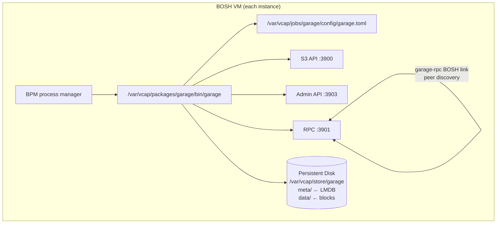

# garage-boshrelease

A BOSH release that packages [Garage](https://garagehq.deuxfleurs.fr/) — a
lightweight, S3-compatible distributed object storage system — as a
BPM-managed service for Cloud Foundry and BOSH-based platforms.

## Overview

Garage is a self-hosted, distributed object store built in Rust. It exposes an
S3-compatible API on port 3900, an admin API on port 3903, and an RPC
inter-node channel on port 3901. A single node binds the admin API to
loopback. A cluster binds it to each instance's own IP, because the
lifecycle hooks read each peer's node id and layout version from it. This
release:

- Ships the statically-linked `x86_64-unknown-linux-musl` binary as a BOSH
  blob — no compilation needed on the stemcell.
- Manages the process under BPM with correct persistent disk, ephemeral
  volume, and ulimit settings.
- Uses a `garage-rpc` BOSH link so all instances enumerate peer IPs at
  render time — no hard-coded peer list.
- Bootstraps the cluster layout idempotently from the post-deploy hook on
  the instance with the highest index (opt-out via
  `garage.layout.manual: true`), replaces the role of a node that lost its
  disk, and creates the root S3 key and the default bucket.
- Refuses a change to the replication factor, and refuses to delete a node
  that still holds data, before either can lose anything.
- Delivers `rpc_secret` and `admin_token` via on-disk files, not inline in
  the TOML config, and keeps every secret off command lines.

## Requirements

| Dependency | Version | Notes |
|---|---|---|
| BOSH CLI | v7+ | Required for blob management and release creation |
| BPM | any | Colocated job from the `bpm` BOSH release |
| Stemcell | ubuntu-noble or ubuntu-resolute | The job scripts need only bash, curl, openssl, getent, and awk from the stemcell |
| Persistent disk | 10 GiB+ (production: 100 GiB+) | One disk per instance; `meta/` should be SSD-backed |
| Garage binary | v2.3.0 | Fetched by `scripts/fetch blobs` (or `make download-blobs`) |

No runtime library dependencies: Garage's musl binary is fully statically
linked and has no glibc or OpenSSL requirements on the stemcell.

## Quickstart

**1. Fetch the blob:**

```bash
./scripts/fetch blobs           # or: make download-blobs
```

**2. Create a dev release:**

```bash
bosh create-release --force
bosh -e <your-director> upload-release
```

**3. Deploy (single-node example):**

```yaml
instance_groups:
- name: garage
  jobs:
  - name: garage
    release: garage
    provides:
      garage-rpc: { as: garage-rpc }
    consumes:
      garage-rpc: { from: garage-rpc }
    properties:
      garage:
        rpc_secret: "<64-char-hex-from-openssl-rand-hex-32>"
        admin_token: "<strong-random-token>"
        access_key: "GK<32-hex-chars>"
        secret_key: "<64-hex-chars>"
        replication_factor: 1
  - name: bpm
    release: bpm
  instances: 1
  persistent_disk_type: default
  ...
```

**4. Run smoke tests:**

```bash
bosh -d <deployment> run-errand smoke-tests
```

## Properties

| Property | Default | Description |
|---|---|---|
| `garage.rpc_port` | `3901` | RPC inter-node port, exported via `garage-rpc` link |
| `garage.s3_port` | `3900` | S3 API bind port |
| `garage.admin_port` | `3903` | Admin API port |
| `garage.admin_bind_address` | `""` | Admin API bind address. Empty means loopback for one node and the instance IP for a cluster |
| `garage.s3_region` | `"garage"` | S3 region label in API responses |
| `garage.s3_root_domain` | `""` | Optional vhost-style bucket domain suffix |
| `garage.replication_factor` | `1` | Replication factor (1 = dev, 3 = production) |
| `garage.db_engine` | `"lmdb"` | DB engine: `lmdb` (production) or `sqlite` (dev/test) |
| `garage.metadata_dir` | `/var/vcap/store/garage/meta` | LMDB metadata path — use SSD |
| `garage.data_dir` | `/var/vcap/store/garage/data` | Object block path — HDD-OK |
| `garage.block_size` | `1048576` | Data block size in bytes (1 MiB) |
| `garage.compression_level` | `1` | Zstd compression level (-99 to 22) |
| `garage.metadata_fsync` | `false` | Extra LMDB corruption protection (costs performance) |
| `garage.consistency_mode` | `"consistent"` | `consistent`, `degraded`, or `dangerous` |
| `garage.log_level` | `"info"` | `trace`, `debug`, `info`, `warn`, or `error` |
| `garage.rpc_secret` | *(required)* | 64-char hex cluster secret — identical on all nodes |
| `garage.admin_token` | *(required)* | Admin API bearer token |
| `garage.layout.manual` | `false` | If true, skip auto-bootstrap in post-deploy |
| `garage.layout.capacity` | `"1T"` | Capacity passed to `garage layout assign -c` |
| `garage.access_key` | *(required)* | Root S3 access key id (`GK` followed by 32 hex characters) |
| `garage.secret_key` | *(required)* | Root S3 secret key (64 hex characters) |
| `garage.default_bucket` | `"garage"` | Bucket created for the root key, and used by the smoke tests |
| `garage.bpm.open_files` | `65536` | BPM open_files ulimit |
| `smoke_tests.timeout_secs` | `30` | `curl --max-time` for smoke test requests |

See `jobs/garage/spec` for complete property declarations with types and
descriptions. Properties in the `smoke-tests` job mirror the main job.

## Cluster Bootstrap

A single node starts with `garage server --single-node --default-bucket`. Garage then assigns the layout itself and creates the root key and the default bucket from `garage.access_key`, `garage.secret_key`, and `garage.default_bucket`.

Garage accepts `--default-bucket` only together with `--single-node`, so a cluster starts without either flag, and the lifecycle hooks do that work instead. Two instances in the `garage-rpc` link have special jobs. The instance with the lowest index is the join target, and the instance with the highest index makes the layout changes. We choose both by index rather than by their position in the link, so a gap in the indexes after a scale-down or a recreate doesn't change which instance does what.

1. In post-start, every other instance reads the join target's node id from its admin API (`GET /v2/GetNodeInfo?node=self`, with the admin token) and runs `garage node connect`. The join target tries to connect to every other instance once, so a join target that comes back with a wiped disk finds the cluster again.

2. Post-start accepts a 503 from `/health` while the node has no layout yet, because a cluster has no layout until post-deploy applies one.

3. In post-deploy, the acting instance waits until every instance in the link is a healthy Garage node, and until its own copy of the layout is as new as the newest one any peer reports. It stops with an error if too few nodes are healthy after a minute, because a layout built from part of the cluster could give roles to the wrong set of nodes.

4. It also stops when the layout has staged changes that it didn't make, because `garage layout apply` would commit them without anyone reviewing them. We review them with `garage layout show`, apply them or drop them with `garage layout revert`, and deploy again.

5. It gives each node that shows `NO ROLE ASSIGNED` a role in the zone named after its BOSH AZ, with the capacity from `garage.layout.capacity`. Each role carries two tags, `bosh-id-<instance id>` and `<instance group>/<index>`. A role made by an earlier release has no tags, and when its node is healthy and its address belongs to a link instance, post-deploy adds the two tags while keeping the role's zone and capacity. That change is staged and applied together with any new roles, and it moves no data. A node whose address isn't in the link is left alone.

6. It applies the next layout version, imports the root key, creates the default bucket, and grants the key read, write, and owner access to it.

Every step is idempotent, so later deploys find nothing to do.

When an instance has no BOSH AZ in the link, or its address doesn't resolve, post-deploy prints a warning banner. An instance without an AZ goes into the acting instance's zone, and an instance that doesn't resolve gets no role. Garage spreads replicas across zones, so every instance should have an AZ. For a production cluster with `replication_factor: 3`, each node should be in its own BOSH AZ, so that Garage places the three copies in three zones.

The capacity default of `1T` is a placeholder, and Garage uses it only to share partitions between nodes in proportion to their capacity. Every node gets the same value, so we set `garage.layout.capacity` to roughly the usable size of the persistent disk, and we give every instance the same disk size.

### Manual layout

With `garage.layout.manual: true`, post-deploy never changes the layout, and we assign roles by hand with `garage layout assign` and `garage layout apply`. Until a layout exists, post-deploy logs that it's waiting for one. On the first deploy after we apply a layout, it creates the root key and the default bucket.

### Replacing a lost node

A node whose persistent disk is lost or recreated starts with a new node id and no role, and Garage keeps listing its old role as failed. Post-deploy plans the whole change before it stages anything, and for each node without a role it looks for the old role in this order.

1. BOSH keeps the instance id across a recreate, so a role tagged with the same `bosh-id-<instance id>` under another node id is the instance's old identity.

2. When no role carries that tag, and a new role would leave the layout with more roles than there are instances in the link, post-deploy looks at the failed roles in the node's zone that belong to no other instance. A failed node has no address in `garage status`, so this is how an untagged role from an earlier release is matched. When there's exactly one such role, the new node replaces it.

3. When there's more than one such role, post-deploy can't tell which one belonged to the node. It stops with a message that lists them and changes nothing, and we assign the node by hand with `garage layout assign <new id> --replace <old id>` and deploy again.

4. Otherwise the node gets a new role, as it does when the cluster grows.

The new node is assigned with `garage layout assign --replace <old id>`, which hands the old node's partitions to the new one, and Garage copies the data back from the surviving replicas. Post-deploy never removes a role in any other way.

Once the old node is down, post-deploy runs `garage layout skip-dead-nodes`, so the cluster stops waiting for the old node to acknowledge the new layout. If a failed role is still in the layout after that, post-deploy prints a warning with its id, and we deal with it by hand with `garage layout remove` or `garage layout assign --replace`.

### Root key and bucket

Post-deploy checks the root key, the default bucket, and the key's read, write, and owner grant on the bucket before it touches any of them, so a cluster that already has all three sees no writes. Bucket and key writes need a quorum in every live layout version, which can take a while right after a layout change, so each missing step is retried for up to three minutes before the deploy fails.

## Scaling

Every change to `instances` changes the peer list that's rendered into each node's configuration, so BOSH restarts every instance, one at a time, on every scale.

### Scaling up

We raise `instances` and deploy. The new instances join through the join target, and because the acting instance is the one with the highest index, one of the new instances gives them their roles. Garage then moves partitions onto the new nodes in the background.

A deployment that grows from one instance to several also stops running with `--single-node`, and its admin API moves from loopback to the instance IP. The replication factor stays what it was, as the next section explains.

### Scaling down

Removing a node that still holds a role takes its share of the data with it, so the garage job's drain script refuses to let BOSH delete such a node from a cluster of more than one node. We take the role away first and lower the instance count only after Garage has moved the data.

1. Find the node id of each instance that's going away. `garage status` shows each role's `<instance group>/<index>` tag next to the node id. BOSH normally deletes the instances with the highest indexes, and if it picks a different one, its drain refuses and the deploy stops before anything is lost.

2. On any node, run `garage layout remove <node id>` for each of those nodes.

3. Check the staged change with `garage layout show`, and apply it with `garage layout apply --version <next version>`.

4. Wait until `garage layout history` reports that the cluster is in a stable state with a single live layout version. That means Garage has finished moving the data off the removed nodes.

5. Lower `instances` in the manifest and deploy.

We don't deploy between step 2 and step 5. A deploy in that window still sees the removed nodes in the link, and post-deploy gives them their roles back.

The cluster must keep at least as many nodes as the replication factor, so a cluster with `replication_factor: 3` can't go below three nodes. We also never scale a cluster down to a single instance. With one instance the job starts Garage with `--single-node`, and Garage refuses to start in that mode once the layout has changed more than once.

When drain refuses, it prints these steps. When the role is gone but Garage is still moving data, drain waits up to 30 minutes for the layout to become stable, and then refuses. If a node is already out of the layout and its process can't run, we deploy with `--skip-drain` for that instance group. Deleting the whole deployment with `bosh delete-deployment` drains every instance as well, and every drain refuses, so we pass `--force` to delete a cluster we no longer want.

### Drain on an ordinary stop

When BOSH stops or updates an instance without deleting it, drain waits up to two minutes for the node's block resync queue to empty, so blocks on their way to other nodes aren't cut off. Drain never stops the process itself. bpm stops it after drain returns.

## Replication Factor

Garage can't change the replication factor of a cluster that already has a layout. It refuses to start when the configured value differs from the stored one, and the resulting crash loop is hard to read. Pre-start therefore records the value in `/var/vcap/store/garage/replication_factor` the first time a node starts, and on every later start it compares that value with `garage.replication_factor`. When they differ, pre-start fails before Garage starts and prints what to do. bpm runs the same check before every start, so a restart by monit is covered too.

To keep the cluster, we set `garage.replication_factor` back to the recorded value and deploy again. To move to a new replication factor, we deploy a second Garage cluster with the new value, copy the buckets across with an S3 tool such as rclone, point clients at the new cluster, and then delete the old one. We never try to get around the check by deleting files under the metadata directory, because those files hold the cluster's layout.

A node from an older release has a layout but no marker. Pre-start lets it start, Garage itself checks the stored layout against the configuration, and post-start writes the marker once Garage is running with that value.

## Starting a Stopped Cluster

When every node is down, BOSH still starts them one at a time. The first nodes to start find their peers down and have no quorum, so `/health` answers 503. Post-start waits 45 seconds, and if `garage status` then lists some peers as failed, it accepts the start with a warning so that BOSH goes on to the next instance. The cluster serves reads and writes again once enough nodes are up, and we check `garage status` after the deploy.

A node that can reach all of its peers and still answers 503 after two minutes fails post-start, because something other than missing peers is wrong. A new node with no layout yet is always accepted, because post-deploy gives it a role later.

## Secrets

The RPC secret and the admin token are written by pre-start to files that only `vcap` can read, and `garage.toml` points at those files. The lifecycle scripts never pass a secret on a command line. They send the admin token to the admin API through a curl header file (`curl -H @file`) that only root can read. Post-deploy imports the root S3 key through the admin API (`POST /v2/ImportKey`), with the secret read from another root-only file that pre-start writes, because `garage key import` would put the secret on the command line.

The smoke-tests errand computes its AWS Signature Version 4 HMACs in bash and pipes the input to `openssl dgst -sha256`, so no key material appears on a command line there either. Its secret key comes from a rendered configuration file that the errand restricts to root before it reads it.

The admin API in a cluster listens on the instance IP so that the hooks can read each peer's node id and layout version, and every request to it needs the admin token.

## Upgrading from 0.0.1 (Garage v1)

Release 0.0.1 packaged Garage v1.3.1, and this release packages Garage v2.3.0. Garage v1 and v2 nodes can't run in the same cluster, so a rolling upgrade doesn't work. The [upstream migration guide](https://garagehq.deuxfleurs.fr/documentation/working-documents/migration-2/) says to stop every node and start them all again on v2 at the same time. Garage v2 marks its stored layout the same way v1 does, so the release can't tell a v1 node from a v2 node, and following this procedure is up to us.

1. On any node, run `garage repair --all-nodes --yes tables`, and wait until `garage worker list` shows the repair workers as done.

2. Run `garage meta snapshot --all`. Then copy `snapshots`, `cluster_layout`, `data_layout`, `node_key`, and `node_key.pub` from `/var/vcap/store/garage/meta` on every node to somewhere safe, for example with `bosh scp`.

3. Release 0.0.1 already used `replication_factor` rather than v1's `replication_mode`, so the configuration needs no change for that. Keep `garage.replication_factor` and `instances` exactly as they are for this deploy.

4. Deploy the new release with `bosh deploy --canaries=0 --max-in-flight=100%`, so that BOSH stops every instance and starts them all together.

5. Check `garage status` and `garage layout show`, run the `smoke-tests` errand, and keep an eye on the cluster for the next few hours.

Nodes from 0.0.1 have no replication factor marker, and post-start writes one during this deploy. Their roles have no tags either, and post-deploy tags every healthy one during this deploy.

## Architecture



## Smoke Tests

The `smoke-tests` BOSH errand performs a full S3 round trip against the
cluster with the root key, so it needs no extra key setup. It consumes the
`garage-rpc` link and the `garage.access_key`, `garage.secret_key`, and
`garage.default_bucket` properties. Run it with:

```bash
bosh -d <deployment> run-errand smoke-tests
```

The errand:

1. Probes `GET http://<peer>:3900/` on every peer and fails if any peer does
   not answer.
2. Uploads a small object with a unique key (`smoke-<epoch>-<pid>`) to the
   default bucket via PutObject.
3. Downloads it via GetObject and compares the content.
4. Deletes it via DeleteObject.
5. Confirms it is gone via HeadObject, which must return 404.

Auth uses AWS Signature Version 4, signed with HMACs computed in bash over `openssl dgst -sha256`. No packages beyond the stemcell's base tools are needed. The errand has been exercised against OpenSSL 3.5 and the uutils coreutils that Ubuntu 26.04 resolute ships.

## Release Process

Final releases are created by the `.github/workflows/release.yml` workflow
on tag push. The workflow:

1. Installs the latest BOSH CLI.
2. Downloads the Garage binary from the upstream CDN.
3. Verifies the SHA256 digest.
4. Runs `bosh add-blob` and `bosh upload-blobs`.
5. Runs `bosh create-release --final --version <tag>`.
6. Publishes the `.tgz` and its SHA256 checksum to GitHub Releases.

To trigger a release: push a `v`-prefixed tag (e.g., `git tag v0.2.0 && git push --tags`).

## Contributing

See [CONTRIBUTING.md](CONTRIBUTING.md) for the development workflow, blob
management instructions, and PR guidelines.

## License

Apache License 2.0. See [LICENSE](LICENSE).

Copyright 2026 Cloud Foundry Community.
